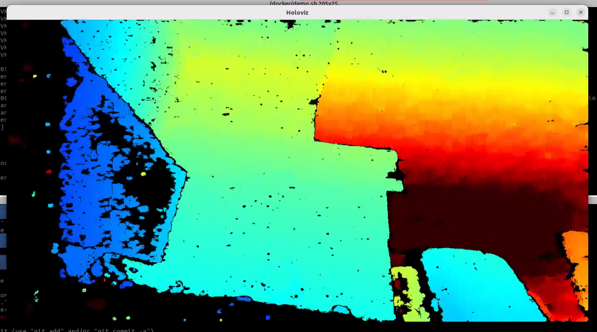
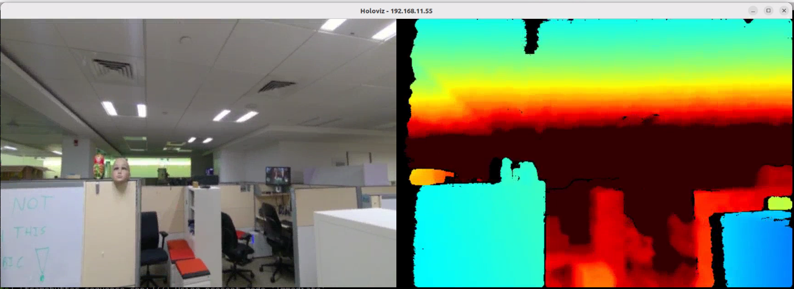

# realsense-sipl

RealSense depth cameras on NVIDIA Jetson through **SIPL/UDDF** and the **Holoscan Sensor
Bridge (HSB)**, covering two independent camera paths:

| Path | Camera | Transport | Where it lives |
| --- | --- | --- | --- |
| **D457 over GMSL** | RealSense D457 (DS5 ASIC + OV9282) | MAX9295A serializer → MAX96712 deserializer → Tegra CSI | `d457-sipl/` |
| **D555 over CoE** | RealSense D555 (HKR SoC) | Camera-over-Ethernet via the Holoscan Sensor Bridge | `d555-sipl/` |

Both deliver frames to Holoscan applications through NVIDIA's
[Holoscan Sensor Bridge](https://github.com/nvidia-holoscan/holoscan-sensor-bridge) 2.7.0, which
`tools/prepare_hsb.sh` sets up with the small patches in [`hsb-patches/`](hsb-patches/README.md).





---

## Two independent projects

`d457-sipl` and `d555-sipl` are **separate projects that share this repository**. They target
different Jetson releases whose SIPL config APIs are mutually exclusive, so neither can be built
from the other's configuration:

| Project | Jetson release | SIPL config API | Rig |
| --- | --- | --- | --- |
| `d555-sipl` | L4T **R38** | `CameraSystemConfig` | `rs-hsb-thor` |
| `d457-sipl` | L4T **R39.2** | `sensorconfig::SensorSystemConfig`, which replaced it | `fw-advantech-thor-1` |

HSB 2.7.0 builds against both APIs, but each project's capture operator targets one of them, so an
HSB tree is set up for one project at a time. HSB itself is not vendored: `tools/prepare_hsb.sh`
clones the pinned 2.7.0 release, applies the shared patches in `hsb-patches/`, copies in the
project's Holoscan code from `<project>/hsb/`, and registers it with that project's
`hsb-registration.patch`:

```sh
tools/prepare_hsb.sh d555      # or: d457; prepares ./holoscan-sensor-bridge (ignored by git)
tools/prepare_hsb.sh --check   # report the HSB version and the project prepared
```

The script is safe to re-run (it copies the project sources again and skips what is already
applied) and refuses a tree prepared for the other project.

## Repository layout

| Path | Contents |
| --- | --- |
| `d457-sipl/` | **D457 over GMSL (R39.2).** The SIPL/UDDF camera-module driver, query plugin, cdi-mgr device-tree overlay, DS5 register tables, SerDes SDK patches, its Holoscan code in `hsb/`, rig tools and tests |
| `hsb-patches/` | Patches against the pinned Holoscan Sensor Bridge release (RAW_16 pixel format, SIPL driver mounts for the demo container); see [`hsb-patches/README.md`](hsb-patches/README.md) |
| `d555-sipl/` | **D555 over CoE (R38).** The UDDF module/sensor drivers, the CoE/HSB transport, its PyHSL sequences, and its Holoscan code in `hsb/` |
| `d555-hsb/` | **D555 over Ethernet on stock HSB 2.7.** Player, dual-stream and PeopleNet examples with `--receiver linux` (software receiver, e.g. the Thor's MGBE) or `--receiver roce` (ConnectX); pure Python, no graft. The same project as `realsense/examples/d555` in the Holoscan Sensor Bridge Hub; see [`d555-hsb/README.md`](d555-hsb/README.md) |
| `d555-roce/` | **D555 over RoCEv2.** Host apps and test tools that receive the D555e's RoCEv2 frames with the stock HSB 2.7 `RoceReceiverOp` on an RDMA NIC (ConnectX-7), into host memory or GPU VRAM; no SIPL, no graft — see [`d555-roce/README.md`](d555-roce/README.md) |
| `resources/` | Screenshots and misc assets |

---

## Building

Everything here targets **aarch64 Jetson**; none of it builds on an x86 host.
The commands below were exercised on a Jetson Thor (Advantech MIC-742, L4T R39.2,
kernel 6.8.12-tegra) with g++ 13.3 and cmake 3.28.

### D457 SIPL driver, deserializer and query plugin

Needs the Jetson SIPL SDK source tree on the device (`.../usr/src/jetson_sipl_api/sipl`).

```sh
# from a checkout of this repository, on the Jetson
d457-sipl/tools/build_deploy.sh -r "$PWD"
```

That syncs the driver sources into the SDK tree, applies the MAX9295/MAX96712 patches, builds
`libuddf_d457cameramodule_library.so`, `libnvuddf_max96712_library.so` and
`libnvsipl_qry_d457.so`, and installs them into `/usr/lib/nvsipl_drv`.
`-c driver,deser,query` selects a subset; see the header of the script for the rest.

For the multi-camera configuration, also apply the four SerDes diffs in
`d457-sipl/sdk-patches/multicam-patches/` to the SDK tree before building — see
[`d457-sipl/sdk-patches/multicam-patches/README.md`](d457-sipl/sdk-patches/multicam-patches/README.md).

### D555 UDDF driver (camera over Ethernet)

```sh
cmake -S d555-sipl -B build/d555
cmake --build build/d555 -j"$(nproc)"
```

Produces `libnvuddf_realsense_library.so` (D555 module + sensor + CoE/HSB transport). The Jetson
Camera SIPL SDK is not vendored — the build uses the copy installed on the device; pass
`-DSIPL_ROOT=/path/to/sipl` to point elsewhere. See [`d555-sipl/README.md`](d555-sipl/README.md).

### Holoscan Sensor Bridge

Prepare the tree for one project, build the HSB container once
([HSB build guide](https://docs.nvidia.com/holoscan/sensor-bridge/getting-started/build)), then build
inside it:

```sh
tools/prepare_hsb.sh d555                 # or: d457
(cd holoscan-sensor-bridge && sh docker/build.sh --igpu)   # once per HSB release: hololink-demo:2.7.0
tools/hsb.sh build                        # SIPL and FuSa on; links build/pyroot
tools/hsb.sh shell                        # the container in the HSB tree, ready to run the players
```

The `hololink-demo` image has the stock `hololink` Python package, without this project's
operators and sensors. `tools/hsb.sh build` therefore also links `build/pyroot`, the tree's Python
sources merged with the modules it compiled, and `tools/hsb.sh shell` sets `PYTHONPATH` to it. Run
`shell` from a terminal on the device's desktop to see the players' windows. A `git pull` that
changes a `hsb-registration.patch` needs a fresh tree: remove `holoscan-sensor-bridge/` and prepare
again.

---

## Running

The D457 players and rig helpers live in `d457-sipl/tools/`. They expect two things from the
environment rather than hardcoding them:

- `RIG_SUDO_PW` — the device's sudo password, for non-interactive `sudo`. Leave it unset to use
  a cached/NOPASSWD sudo instead.
- `VNC_PW` — the password to install for the VNC server the viewer scripts start.

Stream selection is by environment variable: `D457_STREAM=depth|rgb|ir` for a single stream and
`D457_STREAMS=depth,rgb,ir` for the multi-stream players; `D555_STREAM` for the D555 player.

---

## License

This repository is Apache-2.0 — see [`LICENSE`](LICENSE). Third-party code keeps its own notices:

| Path | License |
| --- | --- |
| `hsb-patches/`, `*/hsb/hsb-registration.patch` | Apache-2.0; changes to NVIDIA's Holoscan Sensor Bridge, which is not included here |
| `d555-sipl/hololink/core/` | Apache-2.0 — NVIDIA, from the Holoscan Sensor Bridge |
| `d555-sipl/fmt/` | MIT — [fmtlib/fmt](https://github.com/fmtlib/fmt) |

The **NVIDIA Jetson Camera SIPL SDK is not included**. It is distributed under
`LicenseRef-NvidiaProprietary`, which prohibits redistribution without an express agreement with
NVIDIA, so both `d457-sipl/` and `d555-sipl/` build against the copy installed on the Jetson
rather than vendoring it.

> The four SerDes drivers we had to change more deeply (`MAX9295.{cpp,hpp}`, `MAX967XX.cpp`,
> `MAX967XXHsl.py`) are **not** committed either. They are NVIDIA's code with our edits, so only the
> diffs are kept, in `d457-sipl/sdk-patches/multicam-patches/`, alongside an `apply.sh` that
> reproduces them against a stock SDK tree.
